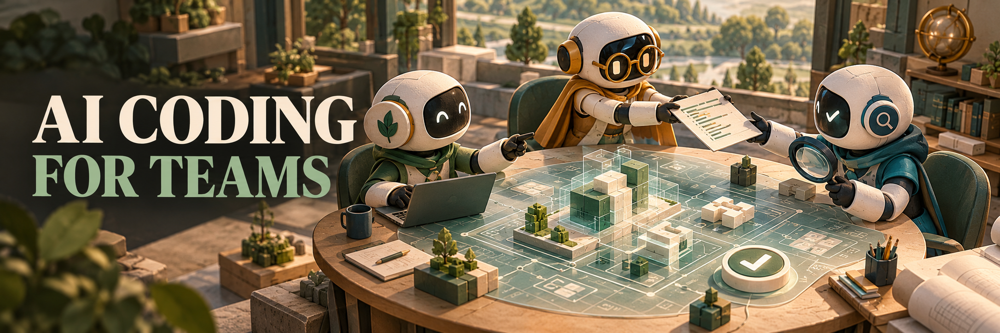

<h1 align="center">AI Coding 团队化实战</h1>

<strong>让一个团队，稳定用好 AI。</strong>

课程已完结 · 14 篇完整文章 · 免费阅读

<a href="https://daviddingxu.github.io/ai-coding-for-teams/"><strong>在线阅读 →</strong></a> &nbsp; / &nbsp; <a href="#文章目录">文章目录</a> &nbsp; / &nbsp; <a href="https://daviddingxu.github.io/ai-coding-for-teams/downloads/ai-coding-for-teams.pdf">PDF</a> &nbsp; / &nbsp; <a href="https://daviddingxu.github.io/ai-coding-for-teams/downloads/ai-coding-for-teams.epub">EPUB</a>

---

个人能用 AI 写出代码，团队为什么仍然难以交付？这门课程从这个问题出发，梳理规则、上下文、任务、验证和协作之间的关系。

适合技术负责人、研发效能团队，以及正在把个人经验推广到团队的开发者。14 篇文章已全部公开，按顺序阅读即可理解整套方法。

你会沿着一条团队交付链往下读：

**共同规则 → 需求拆分 → 有界上下文 → 小步交付 → 验证与接管 → 经验复用**

刚开始建设团队流程，可以先通读；已经遇到具体问题，可以从下面的文章直接进入。

## 文章目录

### 从个人经验到团队系统

- 00 · [个人会用 AI Coding，为什么团队还是用不好？](00-overview.md)
- 01 · [共享运行时：不要让每个应用都重复建设 Agent](01-shared-runtime.md)
- 02 · [SPEC 体系：把规则从 Prompt 里拿出来](02-spec-system.md)

### 从复杂需求到可审查交付

- 03 · [复杂需求拆分：大 PRD 不能直接丢给 Agent](03-requirement-slicing.md)
- 04 · [有界上下文：不是给 Agent 更多，而是给得更准](04-bounded-context.md)
- 05 · [阶段化交付：别让 AI 从一句话直接改代码](05-artifact-delivery.md)
- 06 · [Task 化开发：把大 Diff 拆成可审查的工程任务](06-task-development-review.md)

### 从一次成功到持续复用

- 07 · [验证治理：AI 说“测试失败无关”是不够的](07-verification-governance.md)
- 08 · [资产沉淀：让每次交付反哺下一次任务](08-asset-flywheel.md)

### 从单 Agent 到团队协作

- 09 · [Agent 分层：不要让一个万能 Agent 包办所有事](09-adapter-agent-layering.md)
- 10 · [多工具适配：把共享语义放 Runtime，把工具差异放 Adapter](10-adapter-tooling.md)
- 11 · [协作面：团队如何审查和接管 Agent 产物](11-workspace-collaboration.md)

### 最小试点与收官

- 12 · [团队最小落地包：从一套目录、一条流程、三类规则开始](12-minimal-playbook.md)
- 13 · [写在最后：AI Coding 团队化，最后还是工程问题](13-closing.md)

## 把方法带回团队

[团队最小落地包](12-minimal-playbook.md) 汇总了目录模板、任务流程和规则示例。可以先读懂方法，再选择一个范围清晰的需求试用。

## 交流与许可

欢迎 Star 收藏，按需要回查。问题与勘误请提交 [Issue](https://github.com/DavidDingXu/ai-coding-for-teams/issues)，改进内容请参考[贡献指南](CONTRIBUTING.md)。公众号：**好好用 AI**，可在[阅读站](https://daviddingxu.github.io/ai-coding-for-teams/#community)扫码关注。

文章与图示采用 [CC BY-NC-SA 4.0](https://creativecommons.org/licenses/by-nc-sa/4.0/)，代码采用 [PolyForm Noncommercial 1.0.0](LICENSE)。均限非商业使用，详见[许可说明](LICENSING.md)。
